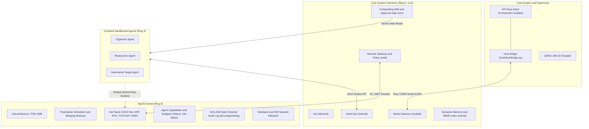

# MyOS — The Hardened AI-Native Operating System

[](https://github.com/PraneetNS/MyOS/actions/workflows/ci.yml)
[](https://opensource.org/licenses/MIT)

> **One-line pitch**: A preemptive 32-bit x86 Unix-like operating system built from scratch in C and assembly, featuring kernel-enforced agent capability sandboxing, hardware killswitches, an in-kernel network stack with mediated TLS gateway, intent-driven IPC, and a cryptographically chained SHA-256 audit log.

---

## ⚡ 30-Second Quickstart

### 1. Download Pre-Built Release Artifacts
Download `myos.iso` and `disk.img` from the [Latest GitHub Release](https://github.com/PraneetNS/MyOS/releases):
```bash
# Verify checksums
sha256sum -c SHA256SUMS
```

### 2. Boot under QEMU (Linux, macOS, WSL)
```bash
qemu-system-i386 -m 128 -cdrom myos.iso -drive file=disk.img,format=raw \
    -netdev user,id=net0 -device virtio-net-pci,netdev=net0
```

### 3. Local One-Liner to Reproduce CI Locally
```bash
make clean && make all && ./userland/build.sh && ./tools/build_disk.sh && ./tools/test_boot.sh
```

---

## 🏛️ Architecture Overview



### ASCII Architecture Diagram
```
+--------------------------------------------------------------------------+
|                  HOST SYSTEM (Untrusted to Guest VM)                     |
|  - Cloud Provider API Keys (Isolated strictly on host, never enter guest)|
|  - Host Bridge Daemon (tools/hostbridge.py) connecting over COM2         |
+------------------------------------+-------------------------------------+
                                     | COM2 Serial / VirtIO Net
=====================================v======================================
+--------------------------------------------------------------------------+
|                         MYOS KERNEL (Ring 0)                             |
|  - Higher-half virtual memory (0xC0000000+), Demand paging, COW fork     |
|  - Preemptive round-robin scheduler with sleeping FIFO mutexes (kmutex)  |
|  - VirtIO-Net driver, in-kernel ARP, IPv4, TCP (AIMD+RTO), UDP, ICMP     |
|  - Agent capability bitmasks: CAP_NET_RAW_INET default-deny              |
|  - Execution budgets: max_tokens, max_net_bytes (atomic -EDQUOT)         |
|  - Emergency unblockable killswitch (PS/2 ISR atomic flag + timer tick)  |
|  - Cryptographic append-only SHA-256 audit log (/proc/agents/log)        |
+-------------------+----------------------------------+-------------------+
                    |                                  |
====================v==================================v====================
+------------------------------------+  +----------------------------------+
|    SYSTEM DAEMONS (Ring 3, root)   |  |   COMPOSITING WINDOW SYSTEM      |
|  - /sbin/init (process supervisor) |  |  - Compositing WM (/run/display) |
|  - intentd (Intent Bus IPC daemon) |  |  - Double-buffered SHM surfaces  |
|  - modeld (token budgets & hashes) |  |  - Server-side titlebars & modal |
|  - netd (domain/port/rate policy)  |  |  - Human Approval Gate           |
|  - memd / indexd (BM25 + vectors)  |  |  - Redacted secrets in A11Y tree |
+-------------------+----------------+  +----------------------------------+
                    | Intent Bus
====================v=======================================================
+--------------------------------------------------------------------------+
|                    SANDBOXED AGENTS (Ring 3, confined)                   |
|  - Bound by principal identities (/proc/agents/<id>/principal)           |
|  - Mediation mandatory: cannot access raw net, raw approval UI, or disks |
|  - Untrusted data framing prevents indirect prompt injections            |
+--------------------------------------------------------------------------+
```

---

## 🛡️ Rigorous Comparison vs. Related Projects

| Concrete Verifiable Axis | **MyOS** | **AIOS** (Rutgers) | **CosmOS** (LLM OS) | **Warmwind** | **VAST AI OS** | **Windows Copilot+ / Workspaces** |
|:---|:---|:---|:---|:---|:---|:---|
| **Underlying OS Kernel** | **Native custom x86 kernel (C/Asm)** | Python userland wrapper on Linux | Prototype / Python wrapper | Custom microkernel | Cloud / Container orchestration | Commercial Windows 11 (NT kernel) |
| **Agent Capability Isolation** | **In-kernel capability bitmask (Ring 0)** | Userland Python process permissions | None (in-process LLM prompt) | Capability microkernel | Container cgroups/namespaces | Win32 token / AppContainer sandbox |
| **Raw Socket Default** | **Default DENY (`CAP_NET_RAW_INET`)** | Allowed (host OS sockets) | Allowed | Policy dependent | Allowed | Allowed (filtered by Windows Defender) |
| **Network Gateway Mediation** | **Daemon (`netd`) with domain/port allowlist, SSRF, & rebinding defense** | External proxy or direct Python `requests` | None (direct API calls) | Direct networking | Ingress/egress Kubernetes network policy | Cloud Edge gateway / PAC file |
| **Hardware / ISR Killswitch** | **PS/2 ISR atomic flag + timer tick context freeze** | KeyboardInterrupt (SIGINT) | None | Soft interrupt | API revoke / kill container | None (manual Task Manager end task) |
| **Tamper-Evident Audit** | **Kernel append-only SHA-256 hash chain** | Flat text file / JSON log | Python logger | System logs | Cloud audit logs (SIEM) | Windows Event Viewer (ETW) |
| **Host Key Secret Isolation** | **Keys stay in host memory; zero guest exposure** | Environment variables in guest container | In-process config / environment | Environment variable | Vault / Kubernetes secret injection | Stored in Windows Credential Manager |
| **Human Approval UI** | **Server-side modal dialog; agent click denied** | CLI terminal prompt | None | UI dependent | None | UAC prompt (Win32 secure desktop) |
| **Prompt Injection Tagging** | **Kernel/daemon mandatory `untrusted: true` wrapping** | Prompt string concatenation | None | None | Prompt guards | Copilot prompt safety classifiers |

### Sources & References
- *AIOS*: LLM Agent Operating System (Mei et al., Rutgers University, arXiv:2403.16971).
- *CosmOS*: An Operating System for LLM-Based Agents.
- *Warmwind*: Microkernel AI OS explorations.
- *VAST AI OS*: Distributed container runtime for AI workloads.
- *Windows Copilot+ / Agent Workspaces*: Microsoft Windows 11 security architecture documentation.

---

## 🎬 Demonstrations You Can Run & Record (`make demo`)

MyOS includes three comprehensive, runnable, and recordable demonstration scenarios:

### 1. `demo-organizer`: Desktop File Organizer Agent
- **Scenario**: Autonomous agent traverses the desktop accessibility tree, summarizes directory contents, and attempts to delete an untracked file (`fs.delete`).
- **Outcome**: The Human Approval Dialog intercepts the action on the server side. The human explicitly denies the deletion, and the aborted action is committed to the immutable audit log.
- **Run**: `make demo-organizer`

### 2. `demo-researcher`: Research Assistant with Untrusted Memory
- **Scenario**: Agent fetches remote technical documentation via `netd`, extracts insights, and indexes findings in `memd`.
- **Outcome**: `netd` enforces domain allowlists, tags output with `untrusted: true`, and `memd` stores the record under `trust=agent`. Subsequent queries wrap recalled knowledge in quarantine blocks, preventing prompt injection.
- **Run**: `make demo-researcher`

### 3. `demo-redteam` (Flagship): Multi-Layer Defense in Depth
- **Scenario**: An adversarial webpage and file attempt three prompt injections:
  1. `fs.delete /etc/master.key` $\rightarrow$ Intercepted by **Window Manager Approval Gate**.
  2. `net.http attacker.com` $\rightarrow$ Blocked by **`netd` Policy Engine** (SSRF & domain allowlist).
  3. `socket(AF_INET, SOCK_RAW)` $\rightarrow$ Denied with `-EACCES` by **Kernel Syscall Boundary**.
- **Outcome**: Every attack vector is defeated by an independent security layer. `auditctl verify` executes at the end, verifying the cryptographic SHA-256 hash chain with 100% integrity.
- **Run**: `make demo-redteam`

---

## 🔒 Security Model & Known Limitations

For our comprehensive threat analysis, trust boundaries, and complete list of known limitations (32-bit single-core, no ASLR/NX, local model constraints), please read:
👉 **[Security Model & Known Limitations](docs/security_model.md)**

---

## 📜 Development History & Architectural Phases

MyOS was developed across six distinct architectural phases:
- **Phase 1: Kernel Core & POSIX Base** (GDT/IDT, PMM, Higher-half VMM, FAT16 LFN, Scheduler, Signals, Pipes, SHM, PTYs, Newlib Libc, Lua 5.4).
- **Phase 2: GUI & Windowing System** (Framebuffer PAT, Compositing WM, `libwin`, `libui`, `term`, `files`, accessibility tree).
- **Phase 3: The Model Daemon & Autonomous Loop** (COM2 serial framing, `modeld`, token budgets, `libllm` local engine, prompt injection defenses).
- **Phase 4: The Agent Desktop & Safety** (UI bridge, server-side approval dialogs, visible status indicators, hardware killswitch).
- **Phase 5: Persistent Memory & Semantic File Index** (Principals, `memd`, BM25 + embedding hybrid search, memory zeroing, `indexd`).
- **Phase 6 & 6.5: Hardened Networking, TLS & Net Gateway** (VirtIO-Net, in-kernel TCP/UDP, BearSSL TLS 1.2, `netd` gateway, DNS rebinding prevention, secret scrubbing, packet fuzzing).

---

## 🤝 Contributing, Security & Community

- **Contributing Guide**: [CONTRIBUTING.md](CONTRIBUTING.md)
- **Security Policy**: [SECURITY.md](SECURITY.md)
- **Code of Conduct**: [CODE_OF_CONDUCT.md](CODE_OF_CONDUCT.md)
- **Roadmap & Good First Issues**: [docs/ROADMAP.md](docs/ROADMAP.md)
- **Third-Party Licenses**: [THIRD_PARTY.md](THIRD_PARTY.md)

---

## 📄 License
MyOS is licensed under the **MIT License**. See [LICENSE](LICENSE) for details.
